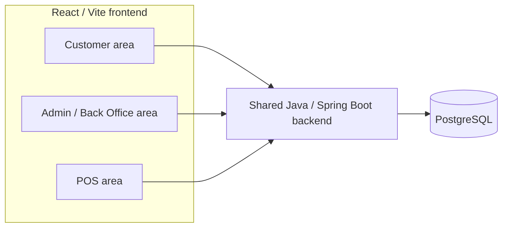

# Architecture

This document defines only the approved high-level architecture. It does not prescribe an unapproved package structure, deployment topology, or integration.

## System context

M4N is a modular monolithic system in one repository. Customer Website, Admin/Back Office, and POS are frontend areas that use one shared backend and PostgreSQL database. They are not independent microservices or separate databases.

## Confirmed technology

- **Frontend:** React 19.2.8, Vite 8.3.0, and ESLint 10.10.0 as currently declared.
- **Backend:** Java 21 and Spring Boot 4.1.1 with Maven Wrapper as currently declared.
- **Database:** PostgreSQL is approved, but its connection, schema, migration tool, and version are not yet configured.

Existing versions must not be upgraded silently.

## Responsibility boundaries

### Frontend

- Present Customer, Admin/Back Office, and POS experiences.
- Collect input, provide UX validation, call backend APIs, and display loading, error, empty, and success states.
- Do not duplicate backend business rules as an authority.

Frontend structure, state ownership, routing/API boundaries, UI behavior, forms, visual decisions, and acceptance are defined in [`FRONTEND_ARCHITECTURE.md`](FRONTEND_ARCHITECTURE.md), [`API_CONTRACT_RULES.md`](API_CONTRACT_RULES.md), [`UI_UX_RULES.md`](UI_UX_RULES.md), [`FORM_VALIDATION_RULES.md`](FORM_VALIDATION_RULES.md), [`DESIGN_SYSTEM.md`](DESIGN_SYSTEM.md), and [`UI_ACCEPTANCE_CHECKLIST.md`](UI_ACCEPTANCE_CHECKLIST.md).

### Backend

- Authenticate users and enforce role/ownership authorization.
- Validate requests and enforce all business rules.
- Calculate and validate authoritative prices, totals, discounts, and revenue.
- Control order transitions, persistence, and transaction integrity.
- Recheck and update inventory safely.

The mandatory backend layers, package convention, JPA access rules, transaction boundaries, and DTO/mapper flow are defined in [`BACKEND_ARCHITECTURE.md`](BACKEND_ARCHITECTURE.md).

### PostgreSQL

- Act as the source of truth for persistent business data.
- Enforce appropriate integrity constraints and support transactional order, payment, and inventory operations.

## Authoritative decisions

The frontend is never the source of truth for permissions, voucher validity, order transitions, inventory, or revenue calculations. Client-provided roles, prices, totals, discounts, and state changes must be revalidated by the backend.

## Prohibited architectural expansion

Do not introduce microservices, separate databases for Customer/Admin/POS, message queues, event buses, or other distributed infrastructure without an explicit approved requirement and architecture update.

## TBD

- API contract and endpoint conventions.
- Backend package/layer structure is defined in `docs/BACKEND_ARCHITECTURE.md`; lower-level API contracts and implementation details remain TBD until their features are approved.
- PostgreSQL version, schema/ERD, and migration tool.
- Authentication/token implementation.
- Payment gateway, deployment provider, cloud provider, and Docker setup.
