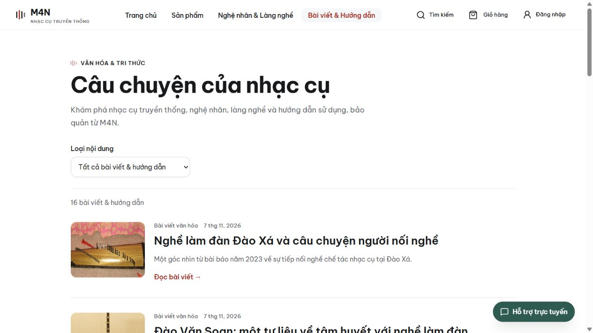

# Full demonstration seed — 2026-11-07

User request: “seed cho đầy đủ”, followed by delegating the choice of the best
approach after being told that demonstration transactions affect inventory and
revenue. Selected a separate, explicitly labelled fixture customer population;
never attributed reviews, purchases or payment success to existing customers.

## Inputs and execution

- Reviewable inputs: [showcase-20261107.json](../../seeds/showcase-20261107.json).
- Before writes, created and checked a full private PostgreSQL custom-format
  backup (251 archive entries), then captured complete table snapshots. Private
  recovery evidence and runner are in the user's local
  `m4n/backups/showcase-seed-20261107-212341` folder, outside Git.
- Provisioned 12 CUSTOMER-only fixture accounts with `example.invalid` emails,
  distinct synthetic phones, random passwords hashed with BCrypt, and “Demo” in
  their display names. Credentials remain private, outside Git. Existing account
  credentials, roles and verification flags were not changed. This explicit seed
  provisioning does not change registration/OTP behavior for ordinary customers.
- Input → validated existing API → business-service calculation/transition →
  committed record and movement → verified database/public response. Only the
  initial fixture account insert uses parameterized SQL; article publication,
  promotions, vouchers, receipt/QC confirmation, order lifecycle, review submission
  and POS checkout all use the existing authenticated backend APIs.
- No gateway requests, invented MoMo/VNPay transaction references, real payment
  charges, shipment creation or outbound receipt email. Existing shipping
  configuration is unchanged (currently no shipping charge); shipping vouchers
  are ready for use when a nonzero configured shipping fee applies.
- Existing active 12-product catalog, 3 categories, 4 artisan profiles and
  8 village profiles are retained. No extra instrument models were added.

## Added data

| Area | Added | Total after seed |
| --- | ---: | ---: |
| Published articles / guides | 16 | 16 |
| Product promotion programs | 6 | 6 |
| Vouchers | 4 | 9 |
| Online COD orders | 21 | 98 |
| Cash POS invoices | 6 | 12 |
| Illustrative product reviews | 12 | 12 |
| Stock receipts | 15 | 15 |
| Fixture customer accounts | 12 | 376 users overall |

- Articles: twelve original, product-specific selection/inspection guides and
  four short cultural pieces, with valid product/artisan/village associations.
  Cultural sources are credited in the content and input file. Public articles
  were first saved as drafts, then published with optimistic version checks.
- This explicitly requested authored seed is an exception to the older
  `CONTENT_CONTRACT.md` prohibition on filling pages with fabricated/seeded
  content; it does not enable automatic filler on application startup.
  No third-party article was copied wholesale, no current artisan activity or
  product provenance was invented, and product images remain illustrations.
- Product promotions: three active, two upcoming, one inactive. New vouchers
  cover manual price, automatic order threshold and two shipping discounts;
  all new voucher usage limits are finite.
- Also archived and removed three unused leftover PM fixture vouchers under the
  previously approved fixture cleanup. All had zero usage and no order, invoice
  or POS payment reference. The new backup includes their original rows.
- Receipts: twelve QC-confirmed batches (including partial rejections) and three
  drafts. Actual cost uses accepted quantity × unit cost. Drafts have no stock
  effect. They support the existing receipt PDF flow.
- New order states: twelve COMPLETED, three PENDING_CONFIRMATION, two CONFIRMED,
  one SHIPPING, one DELIVERED, two CANCELLED. One cancellation follows confirmation
  to exercise stock restoration. Existing order states were not changed. An additional pending two-instrument
  order demonstrates a manual voucher combined with an automatic order discount.
- Each instrument has one review submitted by its own fixture buyer only after
  the corresponding COD order was completed. Every comment says “Bản minh họa”;
  these are not genuine customer endorsements.
- Net inventory increase: 121 units after receipts, confirmed orders, cancellation
  restoration and POS sales. Added demonstration revenue: 48,697,325 VND.
  Production dashboards therefore include these explicit demo amounts.

## Verification

- Manifest validation: unique product codes/phones, bounded content fields,
  valid review ratings and QC quantities.
- Compared all pre-existing order/item/invoice/customer/payment/shipping-setting
  rows with their original snapshots: unchanged. New online payments: zero.
- Verified every inventory balance equals its original balance plus the sum of
  batch movement deltas. Confirmed receipts each have exactly one movement;
  drafts have none. QC accepted + rejected equals requested.
- Verified each review's customer owns its completed, paid COD order and the
  order contains that product. Verified order/invoice totals against line sums.
- All sixteen published article detail APIs returned HTTP 200; public list
  reports sixteen records. Browser verified the article list and a cultural
  article detail with its source and working image. No horizontal overflow on
  the tested desktop list. No application UI code changed.
- A rerun exposed two freshly generated cancellation duplicates because the
  cancellation service appends a reason to notes. Archived and rolled back only
  those two new demo records; their combined inventory delta was zero. Matched
  the stable note prefix thereafter. Final complete rerun created **zero** new
  records or transactions.
- A live PDF check found an existing deployment issue: receipt export returned
  HTTP 409 because Railway lacked a Vietnamese system font. Bundled unmodified
  Be Vietnam Pro Regular and its SIL OFL license in backend resources, and changed
  the existing shared PDF font provider to read it from the JAR. An explicitly
  configured font path keeps its existing precedence and failure behavior.
  No dependency or schema change. Both receipt/invoice generators already use
  this provider. Production needs the backend deployment for this PDF fix;
  the seed itself is already committed in production.
- Added an existing-suite regression check for the bundled font identity and
  Vietnamese glyphs; the existing invoice test checks PDF text extraction.
  Backend `clean verify`: passed, 567 tests, zero failures/errors/skips.
  The packaged Spring Boot JAR contains the exact font bytes and its license.
- No frontend code changed, so frontend lint/build were not rerun for this seed.

Aggregate verification: [20261107-showcase-seed.json](20261107-showcase-seed.json).

